## ATHINI NGQUKE PORTFOLIO

  

  📞:+27 744 665 609  
  📧:222352302@mycput.ac.za  
  🏠:Woodstock, Cape Town  
  💼:http://github.com/Ngquke26                                                                                                 

## PROFILE

I am an active, and goal-driven third year student ICT, and specializing in Application Development. I am currently seeking for a Work Integrated Learning(WIL) opportunity, where I will be applying my programming skills in solving real-life problems, with the goal of gaining more knownledge and experience, which will help me in the future to grow, and become a better experienced software developer.

## TECHNICAL SKILLS
- Java
- Python
- HTML
- Javascript
- CSS
- MySQL

## EDUCATION

**National Senior Certificate (NSC)- Grade 12**
- K.T Mchasa S.S.S
- 2021

**Diploma in ICT Applications Development**
- Cape Peninsula University of Technology
- 2024-Current
  
## WORK EXPERIENCE                                                                                                                                                              
**Hackthon Assistant(Volunteer) |Ocean Hub Hackathon |October 2025**                                                              
- Assisting participants with problem-solving and brainstorming.                                        
- Catering for eight teams, providing food, snacks, and drinks.                                         
- Cleaning up the collaboration environmennt                                                     
                                                                                                   
                                                                                
**Hackathon Participant| Empiras Global Academy Afrihack | September 2025**                                                
- Developed a website-based prototype solving a real-life problem.                                    
- Collaborated with a team of eight students competing against five teams.                             
- Presented the solution to the judges.                                                             
                                                                                                                                                                              
**Independent Sales Agent| Maqutywa Direct Marketing |June 2023-December 2023**                                                                          
- Creating clothing accounts,and insurance application for customers.                              
- Explaining product details, and payment methods to customers.                                        
- Working on strategies of reaching daily, weekly, and monthly targets.                              
- Handling and uploading supporting documents.

## PROJECTS
- Masakhumzi Community Project Website - HTML, JavaScript, and CSS
- Personal portfolio Website - HTML, JavaScript, and CSS
- Student Learn Hub Application - Java
- Empiras Learner Dashboard Website - HTML, JavaScript, and CSS
- Student Enrollment Application - Java 
  
                                                                                                     
## REFERENCES 

**Ocean Hub Hackathon - Cape Town, Western Cape**                                        
- Full name: Thando Mazomba                                                                       
- Email address:thando@oceanhub.africa                                                            
                                                                                                   
**Empiras Global Academy AfriHack - Cape Town, Western Cape**                            
 - Full name: Lungile Ntuli                                                                       
 - Email address: lungile@empirasglobalacademy.com                                                
                                                                                                   
**Maqutywa Direct Marketing - George, Western Cape**                                       
 - Name: Mthokozisi Maqutywa                                                                      
 - Cellphone number: 078 556 5769

   
## INTERVIEW MOCK VIDEO
 
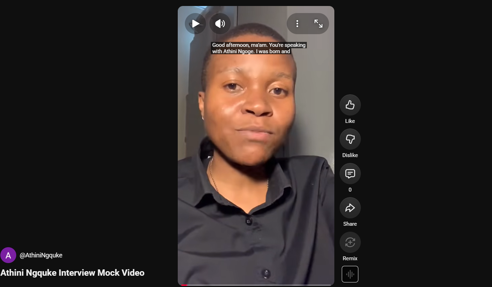
To watch my video on You tube click [here](https://youtube.com/shorts/qxsUnSy0bRI?feature=share)

## CV REFLECTION

**Learning journey**
- Learning a markdown language was not a big  challenge to me because it is similar to one of the programming languages that I am used to, HTML.
- Even though they have differences but I was able to use the little knowledge I gained from HTML with the knowledge I obtained from research.
- But I still did not know where to start.
- I then decided to started by reading the cheat sheet ,we have received from our study guides on blackboard, but still I did not obtain as much knowledge and guidelines on where I should start.
- I used the linkedIn learning platform for seeking guidance on where to start designing a cv and how start.
- I gained knowledge on linkedin learning on how to write headings, semi-headings,lists, and using emoijs from github and implementing that knowledge was not as difficult as I though it would be.
- With all the information from cheat sheets,linkedin learning,YouTube, and internet at large,I managed to come up with a CV with great structure and hierarchy.
- At the end of my learning journey, I received a LinkedIn Certification from the video I was watching on LinkedIn Learning.
- 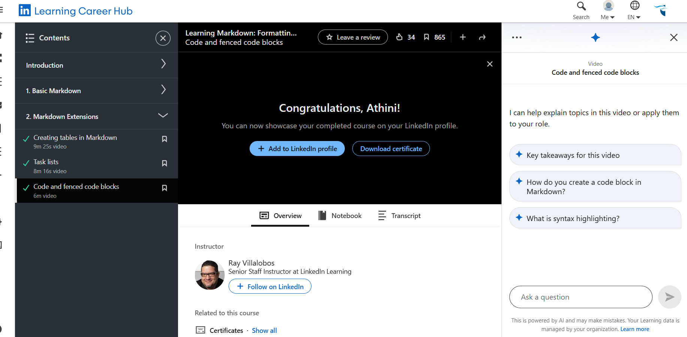

**Challenges faced**
- My Cv before has a two column structure but with Markdown, I faced a challenge when it comes to creating the exact structure.
- I looked for videos on You Tube streaming, hoping that I would find guidance on how to create that layout, but I only got to learn how to create tables which did not help me with developing the layout I needed.
- I then though usings tabs was going to work but when I checked the review of the code, all the information was on the left hand side was
messed up but the order of my sub headings.
- I decided to stick to what I could do, but I made sure that my information is well structured, that there is consistency in the structure I used and that person who is reading the CV would understand.

## REFLECTION ON THE MOCK VIDEO

**Recording interview mock video**
- We were told to record a video that does not exceed 25MB.
- On the video we were instructed to choose 4 interview question that a person will answer.
- While I was recording, I could not structure ny sentences and I was struggling to use the right words.
- I then decided to write down my questions and answers, they practice answering the questions.
- I kept on stuttering because of fear as the experience felt real and reminded me of when I was once in a interview.
- But with practice and dedication, I managed to create a video that is perfect and that does not exceed the size limit.

**Uploading mock video**
- One of the biggest challenges I faced uploading the video from my local computer to myGit hub.
- Before, when we were told by our lecturer to make the video and submit it, the instruction we were given was that the size of the video must not exceed 25MB.
- Back then my video did not exceed the required size and I managed to answer the total amount of questions that were required.
- Now, when I was uploading the video on github, it did not allow me to upload a video of that size.
- I had to compress the video using the Movie clip software  so that it can have small size that github would allow.
- When I managed to upload the video, it was not playing because of the size.
- I had to find another alterative way of uploading the video.
- I created a channel on you tube using the account I always had.
- I tried to upload the original video on You tube but because of the size,I was unable to upload it.
- I then took the compressed video I was trying to upload on github, and tried to upload it on you tube again.
- Because I did not want just anyobe to see and access the video, I uploaded it as unlisted so that it can only be accessed by people who have the link to my video.
- The video was uploaded successfully then I finally managed to embed the link so that it can be accessible through the gitub pages.

  
## LEARNING PROOF

**LinkedIn Learning Certificate**

 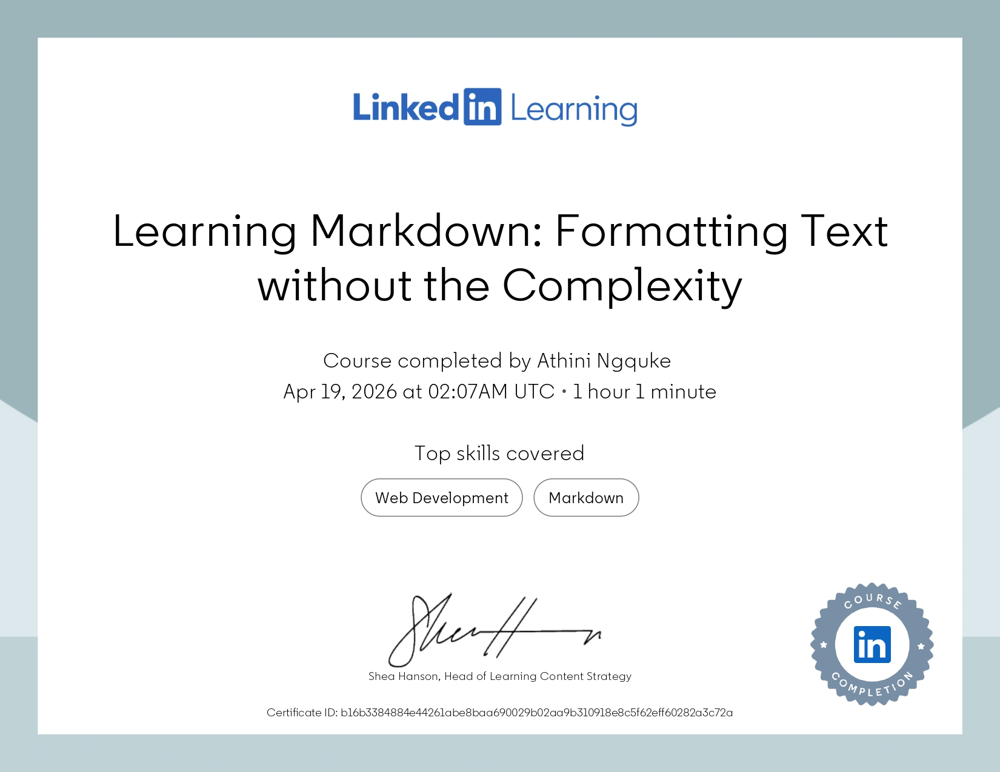
  
**LinkedIn Learning Video**
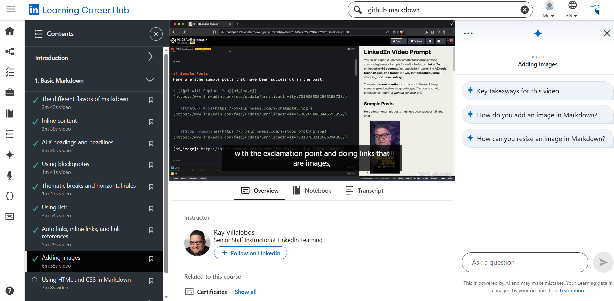
- You can watch the markdown video from Linked in[here](https://www.linkedin.com/learning/learning-markdown-formatting-text-without-the-complexity/using-html-and-css-in-markdown?autoSkip=true&resume=false&u=2256146)

  
**Markdown webiste**
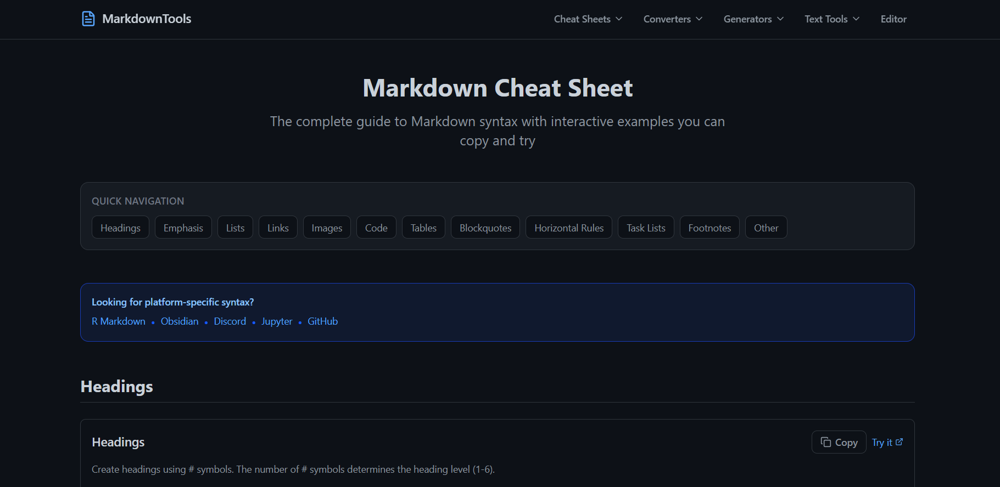
- To visit the Markdown Website[here](https://www.markdowntools.io/cheat-sheet#links)

**YouTube Markdown Video**
 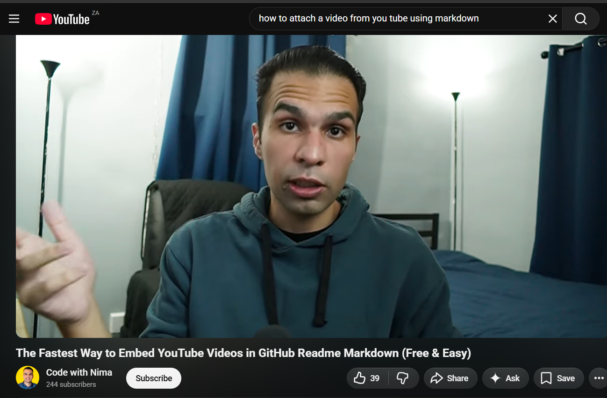
- You can watch the markdown video from You Tube [here](https://youtu.be/iadzYtX4ERU?si=TqucPsEHWaX1_mM0)

## WIL PROJECT PORTFOLIO

 **Agile Team Charter**
 
- To view Agile Team Charter [click here](Agile Logbook/PRP AGILE CHARTER.pdf)

 **Agile Team Charter Reflection**
 - An Agile Team Charter is a document that is written for an agile project, this document has all the roles of the team members, the objective of the project, values of the team and the rules and acceptable behaviours for all the team members.
 - While were designing this document one of the first challenges that I faced, was knowing which role is the best for me with the tasks it contains.
 - To solve this problem, I decide to measure the strengths and weaknesses that I have. This step is crucial in solving this challenge for the role allocation because when you know about your strengths and weaknesses, you can easily decide what role you will excel in.
 - This can also assist the rest of the development team to properly decide which role is the best for you, and to ensure they can pair you with an individual that is has a strength in the field you have a weakness in so that you can learn from that team member.
 - This does not only help one individual but the entire development team to have a culture of continuous learning, so that everyone can also use this opportunity to work on their weaknesses.
 - It can also help the development team in satisfying the needs of the users and designing the best product.
 - When team is experiencing challenges of unacceptable behaviours from certain team members, the agile team charter is a great tool for conflict resolution using the rules, and to remind the team members about the acceptable behaviours that are expected from each member.
 - In the beginning of the project some people might not see the importance of this document, but in the middle of a project when confusion and conflict strikes that is when they will start to see the importance of this document because it solves a lot of challenges on it's own.

**Proof of Learning Agile Team Charter**
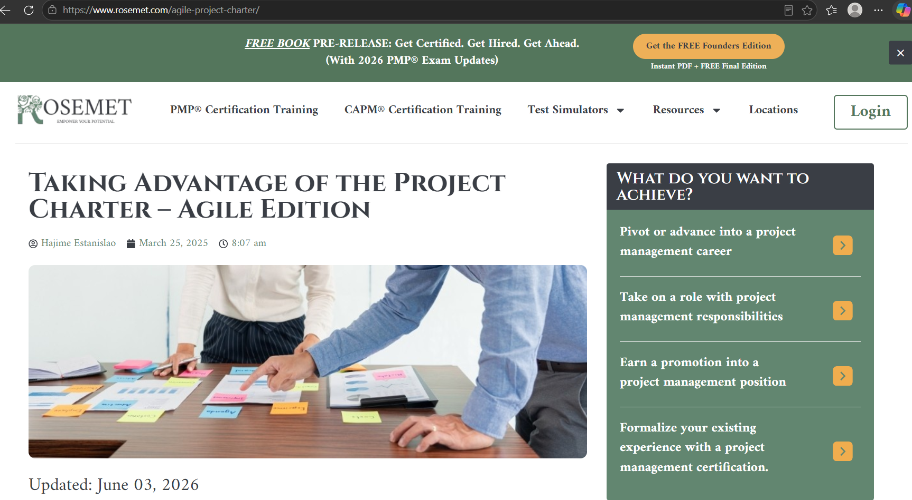
- Click for more [here](https://www.rosemet.com/agile-project-charter/)
  
 **Product and Sprint backlog**
 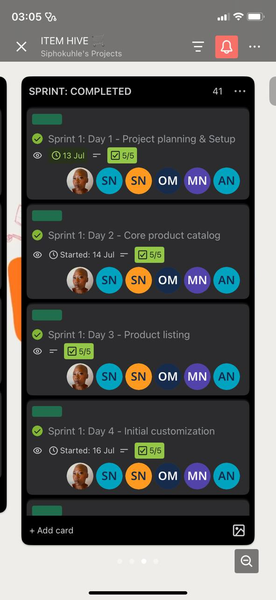
 - You can view the product backlog on Trello on this link [here](https://trello.com/b/jMjTyQX1/item-hive-%F0%9F%9B%92)

 **Product Backlog Reflection**
 - A product backlog is a living document that can always be updated and modified. It has the list all the activities and tasks that are undone, incomplete and have been completed by the team.
 - This document has a role of guiding the development team throughout the project lifecycle to ensure that the need of the stakeholders, customers and that all the requirements are met and the team does not develop scope creep.
 - There are a lot of challenges that I personally encountered with when I was working on the product backlog on Trello as instructed by my supervisor.
 - In the beginning, I was not sure what a product backlog is, what must be included, how to structure it, and it's entire purpose.
 - The main confusion was rooted on the fact that we are a group of six members, we have different roles on the team, we are sometimes working on different tasks and activities, so I could not understand how it must be structured or designed.
 - Thing got worse when I also heard that we need to include a user story.
 - While I was still confused, I had created all the sprints for the week in one window, I had separated the tasks of the members on the sprints, some were included and some were excluded from some sprints, it was a complete disaster.
 - To resolve the confusion, I tried to understand what a sprint is, I was reading more about product backlog and user stories, the purpose of having them, and the feedback from my supervisor on how it must be structured helped in bringing some light.
 - When I understood all the above, I then created windows where each sprint had about four days, each day had an activity for that day, the tasks of all the members, the user story and a starting and ending date of each sprint. This helped me to have the product backlog an user stories with the required structure.
 - The process was not easy, it was time-consuming but it was worth it.

**Proof of Learning Product & Sprint backlog**
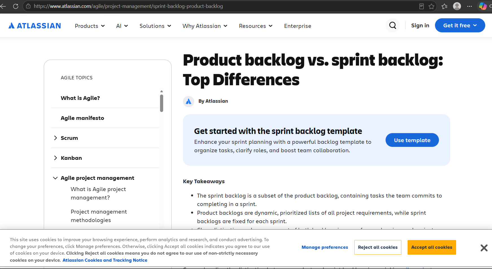
- Click for proof [here](https://www.atlassian.com/agile/project-management/sprint-backlog-product-backlog)
  
 **Agile Logbook**
 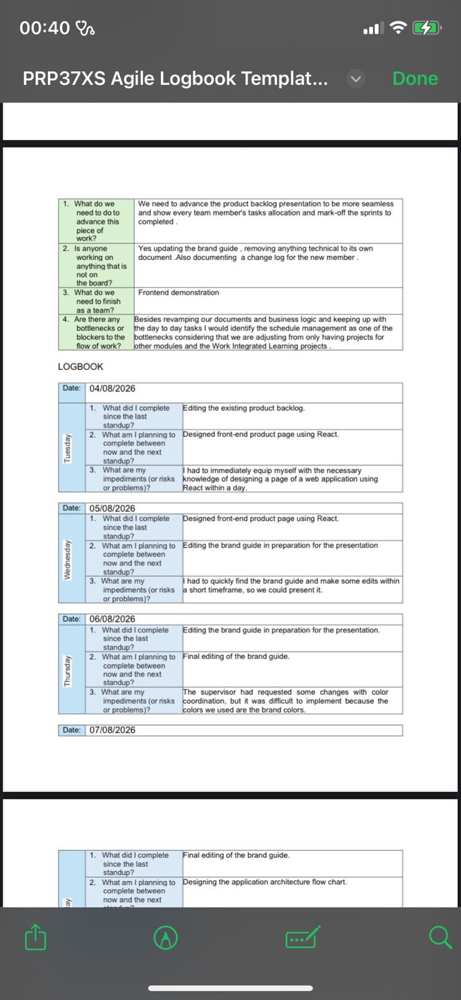
- Logbook 1 [click here to view](Agile Logbook/Agile Logbook  -12-10-26 (AN).pdf)
- Logbook 2 [click here to view](Agile Logbook/Item Hive Agile Logbook 19-10-2026(AN).pdf)
- Logbook 3 [click here to view](Agile Logbook/Item Hive Agile Logbook 23-10-2026(AN).pdf)
- Logbook 4 [click here to view](Agile Logbook/PRP37XS Agile Logbook Template - 07-05-26 (1).pdf)
- Logbook 5 [click here to view](Agile Logbook/PRP37XS Agile Logbook Template -05-10-2026(AN).pdf)
- Logbook 6 [click here to view](Agile Logbook/PRP37XS Agile Logbook Template -21-05-26 (1) (1).pdf)
- Logbook 7 [click here to view](Agile Logbook/PRP37XS Agile Logbook Template -21-09-2026(AN).pdf)
- Logbook 8 [click here to view](Agile Logbook/PRP37XS Agile Logbook Template -28-07-26 (1) (1) (1).pdf)
- Logbook 9 [click here to view](Agile Logbook/PRP37XS Agile Logbook Template -28-09-2026(AN).pdf)
- Logbook 10 [click here to view](Agile Logbook/PRP37XS Agile Logbook Template 04-08-2026 (1).pdf)
- Logbook 11 [click here to view](Agile Logbook/PRP37XS Agile Logbook Template 14-09-2026(AN).pdf)

 **Reflection on Agile Logbook**
 - An agile logbook is a personal notebook that development teams use to record daily standups.
 - Each team member list what they did the previous day, what they are looking for to on the present day, and the challenges and risks.
 - Writing on the agile log book was not a very difficult tasks to do, because of the knowledge and existence of the product and sprint backlog that is providing guidance of what I have done, which sprint I am on, and the tasks that come with the sprint in a particular day.
 - During the project lifecycle, one of the challenges I was facing was being stuck on a backend task I was doing and not knowing how to continue, but because of having the logbook, I used to list all the challenges I faced during the day, so that I do not forget them, and that used to help during daily standups in managing to bring the issue to the team so that we can find a solution as a team. 
 - I learned that properly designing the product backlog makes the daily standups to be very interested.
 - From the agile logbook and daily standups, I learned about the importance of being honest to yourself and to your team members about the challenges you are facing on the project, and that being honest is not a sign of weakness but another way of getting help and solving the challenges to avoid slowing the team down.
 
**Proof of Learning Agile Logbook**
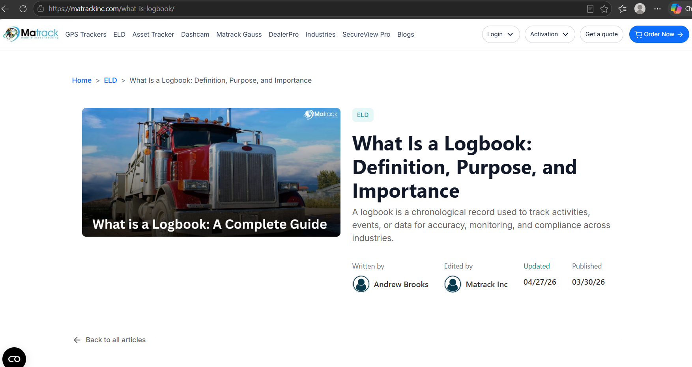
 - Click for proof [here](https://matrackinc.com/what-is-logbook/)

## PROFESSIONAL BRANDING

**Company Logo**
- 

**Brand guide**

- To view a document with the brand guide click[here]()

**Business Case**
- .jpeg)
- To read more about our business click[here](Agile Logbook/ITEM HIVE.pptx)

- .jpeg)
- For a full document with the solution architecture click[here]()

## E-COMMERCE APPLICATION
- 
- To view a deployed version of our application[click]()

